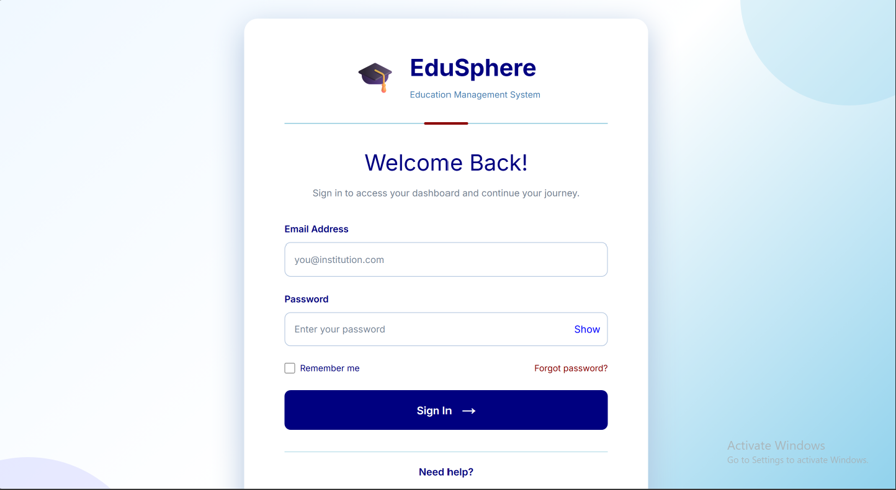

EduPort – Student Management System

EduPort is a web-based Student Management System developed to simplify student information management and administrative tasks.

Project Overview

This project focuses on providing a simple and user-friendly interface for managing student-related information.

Technologies Used

* Next.js
* React
* TypeScript
* CSS

  ##Screenshots
  
  

  
  
